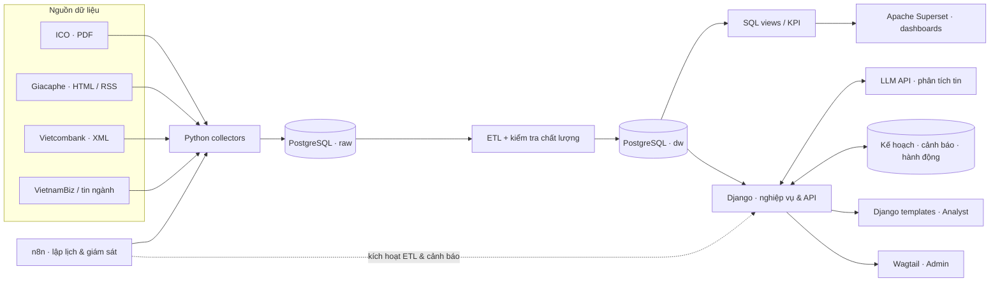

# ☕ CafeFlow Market BI

### Hệ thống BI & AI hỗ trợ theo dõi thị trường và ra quyết định thu mua cà phê

**Nguồn dữ liệu → Kiểm soát chất lượng → Kho dữ liệu → Phân tích BI → Cảnh báo → Hành động**

Python · Django · PostgreSQL · Apache Superset · n8n · Wagtail · Docker <em>(công nghệ dự kiến)</em>

> [!IMPORTANT]
> **Trạng thái:** README này mô tả **thiết kế, mục tiêu và kết quả khảo sát nguồn**, chưa phải xác nhận toàn bộ hệ thống đã triển khai. Lần khảo sát nguồn được ghi nhận trong tài liệu gốc là **18/11/2026**. Các hạng mục R01–R17 ban đầu đều ở trạng thái **CXN (chưa xác nhận triển khai)**.

### ✨ Điểm nổi bật

| 📥 Thu thập & chuẩn hóa | 📈 Phân tích BI | 🧠 AI có chứng cứ | 🧾 Quy trình nghiệp vụ |
|:---|:---|:---|:---|
| Dữ liệu giá, tỷ giá và tin ngành từ nhiều nguồn; giữ bản gốc, ngày hiệu lực, lịch sử sửa đổi | 3 dashboard dự kiến: **thị trường**, **kế hoạch thu mua**, **chất lượng nguồn** | Phân loại tin, trích sự kiện và diễn giải trên dữ liệu có **nguồn/evidence** | Lập kịch bản chi phí, cảnh báo, giao người phụ trách, lưu trạng thái và nhật ký xử lý |

### 🗺️ Xem nhanh

- **Người dùng:** `Admin` và `Analyst` (thu mua/phân tích tại cơ sở rang xay nhỏ).
- **Trọng tâm:** Robusta; giá chỉ báo ICO, giá được Giacaphe công bố, tỷ giá USD/VND và tin ngành. Không đánh đồng các loại giá.
- **Nguyên tắc:** Phép tính chi phí, chuyển đổi đơn vị và quy tắc cảnh báo dùng **mã xác định**; LLM dùng để đọc, phân loại và diễn giải thông tin.
- **Bản chính (MVP):** Collector/ETL + kho dữ liệu + 3 dashboard + AI tin tức + cảnh báo/kế hoạch + web hai vai trò + điều phối n8n + Docker.

<strong>📑 Mục lục — nhấn để mở</strong>

- [01. Tổng quan](#tong-quan)
- [02. Bài toán & lý do chọn đề tài](#ly-do)
- [03. Mục tiêu & câu hỏi kinh doanh](#muc-tieu)
- [04. Phạm vi & người dùng](#pham-vi)
- [05. Nguồn dữ liệu & kiểm chứng](#nguon-du-lieu)
- [06. Kiến trúc hệ thống](#kien-truc)
- [07. ETL & chất lượng dữ liệu](#etl)
- [08. Kho dữ liệu & OLAP](#kho-du-lieu)
- [09. AI & phương pháp đánh giá](#ai)
- [10. BI, KPI & dashboard](#bi-kpi)
- [11. Cảnh báo & hành động](#canh-bao)
- [12. Website, phân quyền & tự động hóa](#phan-quyen)
- [13. Công nghệ & sản phẩm kỹ thuật](#cong-nghe)
- [14. Phân công nhiệm vụ](#nhan-su)
- [15. Lộ trình thực hiện](#lo-trinh)
- [16. Tiêu chí nghiệm thu & theo dõi](#nghiem-thu)
- [17. Rủi ro & phương án dự phòng](#rui-ro)
- [18. Sản phẩm bàn giao & demo](#ban-giao)
- [19. Nguồn tham khảo](#tham-khao)

---

## ☕ 01 · Tổng quan

CafeFlow Market BI là hệ thống hỗ trợ bộ phận thu mua của cơ sở rang xay theo dõi thị trường nguyên liệu. Hệ thống tự thu thập giá, tỷ giá và tin ngành từ nhiều nguồn theo lịch; chuẩn hóa vào kho dữ liệu; phân tích bằng Apache Superset; tạo cảnh báo và hỗ trợ người dùng lập kịch bản chi phí, ghi nhận hành động xử lý.

Sản phẩm khép kín luồng nghiệp vụ từ thông tin thị trường đến quyết định cần rà soát: dữ liệu mới → kiểm tra chất lượng → chỉ số BI → nhận định có nguồn → cảnh báo → người phụ trách xác nhận và ghi hành động. AI hỗ trợ đọc tin và diễn giải; các phép tính ngân sách, giá quy đổi và điều kiện cảnh báo do mã xác định thực hiện.

---

## 🎯 02 · Bài toán & lý do chọn đề tài

Giá quốc tế, bảng giá trong nước và tỷ giá khác đơn vị, thời điểm và loại giá. Nếu tra cứu rời rạc, người phụ trách có thể dùng dữ liệu cũ, so nhầm hợp đồng hoặc khó giải thích tác động lên ngân sách. Đây là vấn đề nghiệp vụ cần xác nhận thêm qua trao đổi với 1–2 người có kinh nghiệm thu mua hoặc rang xay; chưa tuyên bố đã khảo sát doanh nghiệp.

So với bản phân tích giỏ hàng lịch sử, hướng thị trường tạo nhu cầu thu thập mới và đầu ra kinh doanh rõ hơn. Hướng nghiên cứu món cà phê thịnh hành có sức hấp dẫn nhưng khó lấy dữ liệu tiêu thụ đại diện; lượt xem và công thức không đủ chứng minh nhu cầu mua. Vì vậy nhóm chọn thu mua nguyên liệu làm phạm vi chính.

Nhóm học cách tổ chức nguồn, ETL và câu hỏi thị trường từ đề cương nhóm 1; kế thừa cách gắn insight với bộ phận xử lý, nhật ký chất lượng và kiểm chứng nguồn từ nhóm 3. Giữ kiến trúc gọn, không kế thừa toàn bộ mô hình hoặc số dashboard của các nhóm tham khảo.

---

## 🧭 03 · Mục tiêu & câu hỏi kinh doanh

| Mục tiêu | Đầu ra | Câu hỏi cần trả lời |
| --- | --- | --- |
| Tự thu thập đa nguồn | Collector có lịch chạy, raw và lịch sử thay đổi. | Dữ liệu nào mới và nguồn nào đang chậm? |
| Phân tích thị trường | Kho chung, KPI nhất quán, dashboard. | Giá nào biến động và có so sánh cùng loại không? |
| Hỗ trợ thu mua | Kế hoạch, kịch bản chi phí và cảnh báo. | Chi phí tham chiếu thay đổi bao nhiêu so ngân sách? |
| Ứng dụng AI có căn cứ | Chủ đề, sự kiện và bản tin dẫn nguồn. | Tin mới nói về yếu tố nào cần bộ phận thu mua xem xét? |
| Theo dõi hành động | Người phụ trách, trạng thái và nhật ký. | Cảnh báo đã được xử lý ra sao và dựa vào thông tin nào? |

---

## 📌 04 · Phạm vi & người dùng

Người dùng chính là nhân viên thu mua hoặc người phân tích của một cơ sở rang xay nhỏ. Cơ sở được dùng làm bối cảnh thiết kế; chưa có dữ liệu giao dịch nội bộ được xác nhận. Theo dõi Robusta là trục chính; giá chỉ báo ICO, tỷ giá USD/VND và tin tức bổ sung bối cảnh. Các loại giá được lưu và diễn giải riêng.

| Mức phạm vi | Nội dung | Điều kiện |
| --- | --- | --- |
| Bắt buộc | Thu thập giá/tỷ giá/tin; kho dữ liệu; ba dashboard; AI tin tức; kế hoạch và cảnh báo; web hai vai trò; n8n; Docker. | Chốt loại giá và nguồn dùng sau hai ngày thử parser; ưu tiên một cơ sở và một quy trình thu mua. |
| Mở rộng | Dự báo giá một chuỗi, trợ lý hỏi đáp có dẫn chứng, cảnh báo ra kênh ngoài, MCP tạo biểu đồ. | Chỉ triển khai sau khi luồng chính ổn định, có dữ liệu/quyền truy cập và thời gian. |
| Ngoài phạm vi | Đặt lệnh kỳ hạn; tự động quyết định mua; POS/luật combo; ERP/CRM hoặc kho đầy đủ; tư vấn dinh dưỡng. | Không khẳng định giá xanh là giá hạt rang; không suy ra lợi nhuận, tiết kiệm hay nhu cầu món uống từ dữ liệu không hỗ trợ. |

---

## 📡 05 · Nguồn dữ liệu & kiểm chứng

Hệ thống sử dụng **3 nhà cung cấp độc lập cho dữ liệu giá/tỷ giá** (ICO, Giacaphe, Vietcombank) và các nguồn tin ngành bổ sung. Lịch bên dưới là **dự kiến**, không phải bằng chứng collector đã chạy ổn định.

### Lịch thu thập và kết quả khảo sát

| Nguồn / lịch dự kiến | Dữ liệu & cách lấy | Ghi nhận khảo sát 18/11/2026 |
| --- | --- | --- |
| **ICO** · [1–3] Kiểm tra hằng ngày | Tải PDF I-CIP tháng hiện tại; trích ngày và năm chuỗi giá chỉ báo; nạp tháng trước để bổ sung lịch sử. | Tải mẫu HTTP 200 và đọc bảng số; mẫu mới nhất có giá đến 16/11. Chưa kiểm chứng parser đủ các tháng. |
| **Giacaphe** · [4] 08:00 & 16:00 | Thu HTML bảng giá, giá kỳ hạn theo từng hợp đồng và giá nội địa khi có trường; lưu bản gốc và ngày nguồn. | HTTP 200, có bảng kỳ hạn trong HTML. Một dòng nghi sai high/low; ô giá từng tỉnh chưa đọc đủ. |
| **Vietcombank** · [5–6] 08:00 & 16:00 | Đọc XML USD gồm mua tiền mặt, mua chuyển khoản và bán; giữ thời điểm hiệu lực. | HTTP 200; đã parse được DateTime và ba trường USD. Chưa có chuỗi lịch sử tỷ giá dài. |
| **Tin ngành** · [7–9] Mỗi 6 giờ | RSS Giacaphe; duyệt link chuyên mục VietnamBiz; bài Tạp chí Công Thương làm mẫu nguồn bổ sung. | RSS parse được 20 mục nhưng thưa tin; chuyên mục VietnamBiz và một bài Tạp chí Công Thương tải được HTTP 200. Chưa có collector phân trang hoàn chỉnh. |

> [!NOTE]
> **ICO I-CIP là giá chỉ báo**, không phải giá giao dịch kỳ hạn ICE. Nguồn kỳ hạn được Giacaphe công bố lại cần ghi đúng xuất xứ và xác nhận điều kiện chấp nhận với giảng viên; chưa có xác nhận feed trực tiếp ICE.

### 5.1 · Phân biệt nguồn và giá trị sử dụng

Ba nhà cung cấp độc lập cho luồng giá/tỷ giá là ICO, Giacaphe và Vietcombank. Nguồn báo chí bổ sung bối cảnh; tin dẫn lại Giacaphe không được tính như một nguồn giá độc lập để xác nhận chéo. Tự thu thập nghĩa là chương trình nhóm lấy dữ liệu theo lịch từ các nguồn được phép, lưu nguyên bản và cập nhật tăng dần; dữ liệu có thể xuất CSV nhưng CSV tải sẵn không làm nguồn đầu vào duy nhất.

Giá ICO là giá chỉ báo quốc tế, không phải giá giao dịch kỳ hạn ICE. Trang đặc tả ICE xác nhận hợp đồng Robusta báo USD/tấn [10]; chưa xác nhận được feed tự động trực tiếp. Dữ liệu kỳ hạn trên Giacaphe là nguồn công bố lại và phải ghi đúng xuất xứ. Trong hai ngày đầu, nhóm xác minh điều khoản, khả năng parser và làm rõ với giảng viên nguồn công bố lại có đáp ứng yêu cầu nguồn sàn không. Nếu trực tiếp sàn là bắt buộc mà chưa có quyền truy cập, phần này chưa đạt điều kiện chốt.

### 5.2 · Trường dữ liệu tối thiểu

Mọi bản ghi giữ source_id, source_url, effective_at hoặc published_at, collected_at, batch_id, content_hash và quality_status. Giá có commodity, price_type, market, contract_code, currency và unit. Tin có title, văn bản được phép lưu, ngôn ngữ và URL gốc. Không suy ra giá thiếu; không ghi collected_at thay ngày giao dịch.

### 5.3 · Dữ liệu ban đầu và cập nhật

Backfill ICO từ các PDF tháng công khai, mục tiêu 6–12 tháng nếu parser và quyền sử dụng đáp ứng. Nguồn tin được duyệt lịch sử theo chuyên mục để xây tập đánh giá; mục tiêu ban đầu 100 tin liên quan, không khẳng định đã thu đủ. Tỷ giá và bảng giá được lưu snapshot từ ngày chạy; chưa có lịch sử thì chỉ so từ các quan sát đã thu. Kiểm tra nguồn mỗi ngày không đồng nghĩa nguồn công bố dữ liệu mới mỗi ngày.

### 5.4 · Giới hạn và phương án dự phòng

Nguồn thưa tin được bổ sung bằng chuyên mục đã thử tải và báo cáo ICO công khai [11]. Nguồn lỗi dùng snapshot trước với nhãn ngày hiệu lực; cảnh báo quá hạn, không giả cập nhật. Không vượt đăng nhập hoặc lớp trả phí; xác minh điều khoản, giới hạn tần suất và tránh phát hành toàn văn tin. Lịch sử hoặc cấu trúc chưa thử phải được ghi cần xác minh trong báo cáo nguồn.

---

## 🏗️ 06 · Kiến trúc hệ thống

Tầng nguồn gồm PDF, HTML, XML và RSS. n8n gọi tác vụ Python lấy và lưu vào schema raw; ETL đưa bản hợp lệ sang dw. Django cung cấp API nghiệp vụ và gọi AI; kết quả phân tích, cảnh báo và bản tin được lưu lại. Superset đọc view BI bằng tài khoản riêng. Wagtail quản trị nguồn, dữ liệu cần duyệt; Django template cung cấp màn hình phân tích, kế hoạch và xử lý cảnh báo. Docker Compose chạy web, PostgreSQL, Superset và n8n.

Mỗi collector là một module cấu hình được; không cần microservice riêng cho từng nguồn. n8n chỉ điều phối tác vụ và theo dõi trạng thái. Tránh giữ cùng một logic ETL ở cả n8n và backend; pipeline dùng chung hàm chạy thủ công và chạy theo lịch.

### Sơ đồ luồng dữ liệu & các lớp ứng dụng

*Đây là kiến trúc **dự kiến** theo đề cương; sơ đồ không xác nhận các dịch vụ đã hoạt động.*

---

## 🔄 07 · ETL & chất lượng dữ liệu

| Bước | Cách thực hiện | Bằng chứng |
| --- | --- | --- |
| Extract | Tải có timeout, retry giới hạn, lưu HTTP status và nội dung gốc trước khi parse. Giữ lịch sử PDF thay đổi cùng URL. | CollectionRun, raw payload, hash và thời điểm. |
| Transform | Chuẩn hóa số, múi giờ, đơn vị, kỳ hạn; loại trùng đúng khóa; xác định chuỗi giá và cờ chất lượng. | Bản chuẩn, raw_id, lỗi và lý do cách ly. |
| Validate | Giá dương; trường bắt buộc; thời điểm hợp lệ; kiểm tra high/low khi cùng kỳ; tin liên quan và trùng nội dung. | QualityIssue, mẫu kiểm tra thủ công và số bản lỗi. |
| Load | Nạp tăng dần, upsert đúng khóa; lưu sửa đổi; nạp dimension trước fact. AI chỉ xử lý nội dung mới/thay đổi. | Nạp lại không tăng trùng; khôi phục được từ raw. |

Dữ liệu bị nghi lỗi không đi vào KPI chính. Không lấy trung bình các nguồn khác chất lượng, hợp đồng hay ngày hiệu lực để chữa sai lệch. Các bài dẫn lại cùng một sự kiện được gắn nhóm để tránh gọi số bài là số sự kiện độc lập. Lưu riêng nguồn báo, nguồn số liệu được trích và bản chất quan sát.

---

## 🗃️ 08 · Kho dữ liệu & OLAP

| Bảng fact | Grain một dòng | Số đo hoặc trạng thái |
| --- | --- | --- |
| FactPriceObservation | Nguồn × loại giá × hàng/thị trường hoặc hợp đồng × thời điểm hiệu lực × bản sửa. | Giá gốc, quy đổi, quality_status. |
| FactFXObservation | Nguồn × cặp tiền × loại tỷ giá × thời điểm hiệu lực. | Tỷ giá; collected_at. |
| FactNewsAnalysis | Bài × phiên bản nội dung × phiên bản phân tích. | Chủ đề, sự kiện, tóm tắt và trạng thái duyệt. |
| FactPlanScenario | Kế hoạch × phiên bản kịch bản × bộ observation đầu vào. | Khối lượng, chi phí tham chiếu, ngân sách. |
| FactAlert và FactCollectionRun | Một cảnh báo; một lần chạy collector. | Mức ưu tiên, trạng thái; dòng nhận/lỗi, thời gian chạy. |

Dimension dùng chung: DimDate, DimSource, DimInstrument (hàng, loại giá, hợp đồng), DimMarket, DimUnit và DimTopic. Bảng vận hành gồm Users, PurchasePlan, Watchlist, AlertAssignment, ActionLog và BriefRun; dữ liệu cá nhân không đưa vào view công khai. Lưu raw_id và observation_id để truy vết giá dùng trong từng kịch bản.

OLAP: roll-up ngày lên tuần/tháng; drill-down thị trường → hợp đồng → nguồn; slice Robusta; dice ngày × loại giá × nguồn; pivot chủ đề × tuần. Không cộng giá. Tổng hợp từng fact trước khi ghép theo thời gian để tránh nhân bản số liệu.

---

## 🤖 09 · AI & phương pháp đánh giá

### 9.1 · Phân loại tin và trích sự kiện thị trường

Một LLM qua API nhận văn bản nguồn, trả JSON với các trường relevant, topics, event_type, commodity, geography, event_date, evidence và uncertainty. Chủ đề gồm cung cầu, thời tiết/mùa vụ, xuất khẩu, chính sách và yếu tố khác. Tách nhận định của bài báo khỏi sự kiện đã nêu; thiếu ngày hoặc số liệu trả null. Nội dung không liên quan không được đưa vào bản tin.

Backend kiểm tra schema, dẫn chứng có trong văn bản, mã nguồn và trường bắt buộc trước khi lưu. Lưu phiên bản prompt, model, content_hash và thời điểm. Không coi việc gọi API là đã chứng minh AI chính xác; Analyst có thể đánh dấu cần sửa, Admin quản lý phiên bản.

### 9.2 · Bản tin thị trường có căn cứ

Tạo bản tin ngày hoặc tuần gồm diễn biến giá, độ mới dữ liệu, tin đáng chú ý và việc cần rà soát. Backend tính số liệu từ view và cấp evidence_id cho từng quan sát; LLM chỉ diễn giải trên bộ chứng cứ đã chọn. Giá và tỷ lệ được chèn từ mã tính toán, không để LLM tự tính. Bản tin lưu kỳ quan sát, bảng chỉ số đầu vào, danh sách URL, phiên bản và trạng thái duyệt.

Khi có chênh lệch nguồn, bản tin nói rõ khác biệt và yêu cầu kiểm tra thay vì chọn tùy ý một giá. Không có dữ liệu mới thì nêu dữ liệu gần nhất; không sinh câu chuyện để lấp chỗ trống. Đây là chức năng tổng hợp trên cùng dịch vụ AI, không phải thêm một mô hình huấn luyện.

### 9.3 · Phát hiện biến động và ưu tiên kiểm tra

Phần bắt buộc dùng ngưỡng thay đổi do người dùng cấu hình, mức vượt ngân sách và tuổi dữ liệu. Có thể thêm cờ biến động khác thường bằng cửa sổ lịch sử khi đủ số quan sát; khi chưa đủ thì chỉ dùng ngưỡng cấu hình. Quy tắc thống kê được gọi đúng là quy tắc phát hiện, không trình bày như mô hình học máy. AI gợi ý danh sách việc cần kiểm tra dựa trên cảnh báo; người dùng quyết định.

### 9.4 · Kiểm thử AI và phần mở rộng

Mục tiêu lấy 60 tin độc lập: 20 tin phát triển prompt và 40 tin khóa kiểm thử; gộp bài trùng sự kiện khi chia tập. Cả nhóm kiểm tra nhãn theo rubric; hai người cùng chấm một phần để xử lý bất đồng. Đo precision/recall hoặc F1 cho chủ đề và tỷ lệ mệnh đề có căn cứ. Kiểm tra ít nhất 20 bản tin/tình huống về số liệu, nguồn và trường hợp thiếu dữ liệu. Mục tiêu nhãn đúng từ 80%, mệnh đề có căn cứ từ 90%; báo kết quả thật và lỗi, không cam kết đạt trước.

Mở rộng sau MVP: trợ lý hỏi đáp qua danh sách truy vấn chỉ đọc đã kiểm soát, luôn trả nguồn; dự báo một chuỗi giá có tối thiểu 120 quan sát hợp lệ bằng một mô hình đơn giản so với mốc giá kỳ trước, đánh giá theo thời gian bằng MAE. Không trộn các kỳ hạn hay dùng tin tương lai làm đầu vào. Nếu dữ liệu/đánh giá không đủ, không trình bày dự báo như công cụ khuyến nghị mua.

---

## 📊 10 · BI, KPI & dashboard

| KPI | Định nghĩa | Cách sử dụng |
| --- | --- | --- |
| Giá và biến động | Giá mới nhất hợp lệ của đúng chuỗi; (giá mới − giá trước) / giá trước × 100%. | Theo dõi biến động; không nối tùy ý hai hợp đồng. |
| Tuổi dữ liệu | Thời điểm xem − thời điểm hiệu lực; tách lần collector kiểm tra gần nhất. | Phát hiện nguồn cũ, kể cả lần tải thành công. |
| Chi phí tham chiếu | Q kg × giá tham chiếu VND/kg; các đầu vào được lưu cùng kịch bản. | Rà ngân sách; chưa thay báo giá giao hàng. |
| Chênh lệch ngân sách | Chi phí tham chiếu − ngân sách người dùng nhập. | Cờ vượt ngân sách; không phải lợi nhuận. |
| Cơ cấu chủ đề tin | Số bài sạch thuộc chủ đề trong kỳ; báo thêm số nguồn/sự kiện. | Xem bối cảnh được đưa tin; không đồng nhất với sức mua. |
| Tiến độ cảnh báo | Đếm theo trạng thái; tỷ lệ xử lý trong tập cảnh báo đã phát sinh. | Theo dõi công việc; mẫu ít thì trình bày số đếm. |
| Chất lượng pipeline | Tỷ lệ bản hợp lệ; số lần lỗi; giờ chạy gần nhất; số bản mới/sửa. | Rà nguồn/parser; không lấy HTTP 200 thay độ đúng dữ liệu. |

### 10.1 · Quy đổi giá và giới hạn diễn giải

Robusta kỳ hạn VND/kg tham khảo = USD/tấn × tỷ giá VND/USD / 1.000. ICO USD/kg = US cents/lb × 0,01 / 0,45359237. Lưu loại tỷ giá đã chọn; không dùng tỷ giá hôm nay để diễn giải giá lịch sử như chi phí thực lúc đó. Giá quy đổi không bao gồm giao hàng, chất lượng, thuế, rang hao hụt và phụ phí nếu chưa nhập. Chênh lệch giá nội địa và quốc tế không tự động là lợi nhuận hay cơ hội mua bán.

### 10.2 · Ba dashboard vừa sức

| Dashboard | Biểu đồ và bảng | Quyết định hỗ trợ |
| --- | --- | --- |
| Thị trường và bối cảnh | Đường giá; biến động theo chuỗi; tỷ giá; bảng tin theo chủ đề. | Chọn tín hiệu cần đọc sâu; xem ngày và nguồn. |
| Kế hoạch thu mua | Chi phí các kịch bản; chênh lệch ngân sách; bảng cảnh báo và trạng thái. | Rà ngân sách, xin báo giá, giao người xử lý. |
| Nguồn và chất lượng | Độ mới theo nguồn; lần chạy thành công/lỗi; bản ghi hợp lệ/cách ly. | Phát hiện dữ liệu chưa đủ tin cậy trước phân tích. |

Tổng mục tiêu ít nhất 10 biểu đồ/bảng cho ba dashboard, không phải 10 cho mỗi dashboard. Dùng view BI có sẵn, bộ lọc thời gian, nguồn, loại giá và hợp đồng; drill-down về bản ghi. Giá giữ riêng từng chuỗi. Đối chiếu ít nhất ba KPI với SQL và mẫu nguồn trước demo. Trang chủ web có liên kết dashboard; nhúng Superset là mục tiêu tích hợp sau khi cấu hình xác thực chạy được.

---

## 🚨 11 · Cảnh báo & hành động

| Tín hiệu | Hệ thống cung cấp | Người dùng thực hiện |
| --- | --- | --- |
| Chi phí tham chiếu vượt ngân sách | Số tiền chênh, khối lượng và giá đầu vào; tin liên quan nếu có. | Rà lại khối lượng/ngân sách, xin báo giá, ghi lý do phương án. |
| Giá biến động vượt ngưỡng | Chuỗi, kỳ so sánh, phần trăm, độ mới và bản nguồn. | Kiểm tra ngày/loại giá và trao đổi với nhà cung cấp. |
| Tin đề cập rủi ro nguồn cung | Chủ đề, sự kiện được trích, đoạn căn cứ và URL. | Đọc bản gốc; xác minh điều kiện giao hàng, không tự mua theo nhãn AI. |
| Nguồn thiếu hoặc số liệu nghi lỗi | Lỗi, trường bất thường, ngày dữ liệu hợp lệ gần nhất. | Admin kiểm tra parser/nguồn; Analyst tạm loại khỏi kịch bản. |

Cảnh báo có khóa chống lặp theo quy tắc, chuỗi và kỳ; lưu giá trị, ngưỡng, evidence_id, người phụ trách, thời hạn tự nhập và trạng thái mới/đang rà soát/đã xử lý/bỏ qua. Nhật ký giữ thay đổi và lý do. Không gửi thông báo ngoài hệ thống trong bản tối thiểu; n8n cập nhật cảnh báo trên web.

---

## 🔐 12 · Website, phân quyền & tự động hóa

| Màn hình | Admin | Analyst |
| --- | --- | --- |
| Tổng quan, bảng giá, tin và bản tin | Xem; duyệt bản tin và dữ liệu cần rà. | Xem, lọc và mở nguồn. |
| Kế hoạch và danh sách theo dõi | Quản lý theo quyền; xem nhật ký. | Tạo/sửa kế hoạch của mình, lưu kịch bản và chuỗi theo dõi. |
| Cảnh báo và xử lý | Giao việc, theo dõi toàn bộ. | Xử lý cảnh báo được giao; ghi lý do. |
| Nguồn và vận hành | Cấu hình nguồn/lịch, kích hoạt nạp lại, xem raw/lỗi, quản lý quyền. | Xem độ mới và chất lượng; không sửa nguồn/quyền. |

Backend kiểm tra quyền trên từng API và đối tượng, không chỉ ẩn nút. Các API chính: prices, news, briefs, plans/scenarios, alerts/actions và collection-runs; nhóm chốt JSON, trường lỗi và mẫu phản hồi đầu tuần 1. Không tách React/FastAPI riêng khi Django template đã đáp ứng luồng.

n8n chạy Schedule → gọi collector nội bộ đã xác thực → chờ kết quả ETL → cập nhật KPI/cảnh báo → ghi trạng thái. Có nút chạy thử và đường gọi dùng chung với lịch tự động. Lưu lỗi và thử lại giới hạn; khóa chạy chồng; bảo vệ token tác vụ. Website phải đọc được bản ghi kế hoạch và hành động vừa lưu để chứng minh hệ thống ghi nhận dữ liệu sử dụng thật.

---

## 🧰 13 · Công nghệ & sản phẩm kỹ thuật

Bảng công nghệ là cấu hình triển khai dự kiến. Nhóm chỉ sử dụng thư viện cần cho phần việc; phiên bản được khóa trong tệp phụ thuộc sau khi chạy thử. Mã K giúp đối chiếu công nghệ với phân công và đầu ra ở mục 14, 16. Các chức năng chính dùng chung một backend Django.

### Danh mục công nghệ theo hạng mục

| Mã | Hạng mục | Công nghệ dự kiến |
| --- | --- | --- |
| `K01` | **Thu thập HTTP** | Python, requests |
| `K02` | **Tin và HTML** | BeautifulSoup4, feedparser, parser XML của Python |
| `K03` | **Bảng PDF** | pdfplumber hoặc công cụ trích PDF đã thử |
| `K04` | **ETL và kiểm tra** | Python, pandas, Django ORM |
| `K05` | **CSDL và kho** | PostgreSQL, SQL, psycopg; migration Django |
| `K06` | **Backend và API** | Django, Django REST Framework |
| `K07` | **Quản trị và web** | Wagtail, Django template, HTML/CSS, JavaScript fetch |
| `K08` | **AI có dẫn chứng** | Một LLM API; JSON Schema hoặc Pydantic |
| `K09` | **Phân tích BI** | Apache Superset, SQLAlchemy URI, driver PostgreSQL |
| `K10` | **Tự động hóa** | n8n, Schedule Trigger, HTTP Request |
| `K11` | **Triển khai** | Docker, Docker Compose, biến môi trường và volume |
| `K12` | **Cộng tác và QA** | Git, GitHub Issues/PR; Django TestCase, bộ kiểm tra parser |

<strong>🔎 Chi tiết vai trò công nghệ và minh chứng K01–K12</strong>

#### K01 · Thu thập HTTP

- **Vai trò:** Tải HTML, XML và PDF theo cấu hình nguồn; timeout, retry giới hạn; lưu HTTP status, hash và raw.
- **Đầu ra kiểm tra:** Collector nguồn, cấu hình URL, mẫu raw và CollectionRun.

#### K02 · Tin và HTML

- **Vai trò:** Trích bảng giá, link bài, tiêu đề/ngày; đọc RSS và XML USD. Không dùng trình duyệt tự động nếu HTML đã đủ.
- **Đầu ra kiểm tra:** Parser từng nguồn, dữ liệu chuẩn và mẫu kiểm tra khi thiếu trường.

#### K03 · Bảng PDF

- **Vai trò:** Đọc bảng I-CIP theo tháng; tách ngày và loại giá; bỏ dòng tổng hợp, giữ bản gốc.
- **Đầu ra kiểm tra:** Parser ICO, mẫu đối chiếu, báo lỗi tệp và nhật ký phiên bản.

#### K04 · ETL và kiểm tra

- **Vai trò:** Chuẩn hóa số/đơn vị/ngày, kiểm tra chất lượng, chống trùng và nạp tăng dần. ORM phụ trách ghi theo giao dịch.
- **Đầu ra kiểm tra:** Lệnh ETL chạy lại được, kiểm thử trùng/bản sửa, bảng cách ly lỗi.

#### K05 · CSDL và kho

- **Vai trò:** Tách raw, nghiệp vụ và dw; fact/dimension, view KPI và quyền đọc BI.
- **Đầu ra kiểm tra:** Migration/DDL, từ điển dữ liệu, view SQL, truy vết raw_id.

#### K06 · Backend và API

- **Vai trò:** Xác thực, quyền trên đối tượng; API kế hoạch, kịch bản, cảnh báo, nguồn và tin.
- **Đầu ra kiểm tra:** Hợp đồng JSON, API, mã lỗi và ca kiểm thử đúng/sai quyền.

#### K07 · Quản trị và web

- **Vai trò:** Admin quản trị nguồn; Analyst xem tin, lập kế hoạch và xử lý cảnh báo. Gọi cùng API nghiệp vụ.
- **Đầu ra kiểm tra:** Template, form, bộ lọc, thông báo lỗi và dữ liệu đọc lại sau lưu.

#### K08 · AI có dẫn chứng

- **Vai trò:** Gán chủ đề, trích sự kiện, tạo bản tin trên chứng cứ được cấp; kiểm tra JSON và lưu phiên bản.
- **Đầu ra kiểm tra:** Prompt, kết quả JSON, evidence_id, bản tin và bảng đánh giá độc lập.

#### K09 · Phân tích BI

- **Vai trò:** Đọc view dw, biểu đồ/bộ lọc, truy vấn đối chiếu; cấu hình truy cập dashboard.
- **Đầu ra kiểm tra:** Ba dashboard, tệp xuất cấu hình, SQL KPI và mẫu đối chiếu.

#### K10 · Tự động hóa

- **Vai trò:** Điều phối collector → ETL → cảnh báo; dùng endpoint nội bộ có xác thực, ghi lỗi và tránh chạy chồng.
- **Đầu ra kiểm tra:** Workflow xuất được, lịch chạy, log nhiều ngày và thử lại có giới hạn.

#### K11 · Triển khai

- **Vai trò:** Chạy web, PostgreSQL, Superset, n8n; lưu dữ liệu và cấu hình tách khỏi mã.
- **Đầu ra kiểm tra:** Compose/Dockerfile khi cần, .env.example, README; khởi động lại còn dữ liệu.

#### K12 · Cộng tác và QA

- **Vai trò:** Theo dõi việc, review và tích hợp nhánh; kiểm thử những quy tắc dữ liệu/nghiệp vụ quan trọng.
- **Đầu ra kiểm tra:** Commit/PR, test report, issue còn mở và kết quả xử lý.

### 13.1 · Công nghệ mở rộng có điều kiện

Superset MCP: thử một thao tác đọc dataset/tạo biểu đồ khi môi trường đáp ứng, cần log và ID kết quả. Dự báo thử nghiệm: scikit-learn với một mô hình đơn giản khi đủ chuỗi hợp lệ, so MAE với baseline. Chatbot chỉ đọc dùng cùng LLM API và truy vấn kiểm soát. Các phần này không phải điều kiện nghiệm thu bản chính; chưa bổ sung FastAPI, React, PhoBERT hoặc XGBoost khi không có nhu cầu triển khai tương ứng.

Kế thừa Wagtail ở quản trị; TH1 ở Docker và CSDL–Superset; TH2 ở phân tích AI đưa về BI; TH3 ở web/API và kiểm thử đầu ra. Cấu hình MCP chỉ được ghi hoàn thành sau khi chạy thật và đối chiếu kết quả.

---

## 👥 14 · Phân công nhiệm vụ

Mỗi thành viên chịu trách nhiệm mã nguồn hoặc cấu hình, kiểm thử và demo phần mình. Mã R ở cột cuối nối với bảng nghiệm thu mục 16.2; người hỗ trợ không thay thế người chịu trách nhiệm chính. Trang và Minh nhận giao diện, cấu hình và kiểm tra có dữ liệu/API mẫu sẵn.

### Tổng quan trách nhiệm

| Thành viên | Vai trò chính | Mã đầu ra |
| --- | --- | --- |
| **Bùi Đăng Huy** · Nhóm trưởng | API, kịch bản chi phí, cảnh báo, AI, tích hợp | R08–R10, R12, R17 |
| **Bùi Gia Hiếu** | CSDL nghiệp vụ, API, phân quyền, Docker, n8n | R07, R14–R16 |
| **Vũ Tuấn Hiệp** | Collector, ETL, chất lượng dữ liệu, kho, KPI | R01–R06 |
| **Dương Quỳnh Trang** | Ba dashboard BI, bộ lọc và đối chiếu KPI | R11 |
| **Lưu Tuấn Minh** | Giao diện tin, form xử lý cảnh báo, UI QA | R13 |

<strong>👥 Xem chi tiết nhiệm vụ H1–H4, B1–B4, D1–D4, V1–V4, U1–U4</strong>

#### Bùi Đăng Huy · Nhóm trưởng

- H1. Chốt hợp đồng API cùng Hiếu/Hiệp; logic kịch bản chi phí và giao diện kế hoạch.
- H2. Quy tắc cảnh báo, chống lặp, bằng chứng và gợi ý việc cần kiểm tra.
- H3. Gọi AI trích sự kiện, bản tin; kiểm tra JSON/nguồn; chủ trì đánh giá.
- H4. Review, tích hợp nhánh, kiểm thử end-to-end và hoàn thiện báo cáo.

**Công nghệ/phối hợp:** K06–K08, K12; phối hợp SQL K05 và workflow K10.

**Đầu ra & demo:** R08–R10, R12; chủ trì R17. Demo kế hoạch → chi phí → cảnh báo → bản tin → hành động; lưu đầu vào để đối chiếu.

#### Bùi Gia Hiếu

- B1. Model nghiệp vụ, migration, tài khoản và quyền Admin/Analyst.
- B2. API CRUD kế hoạch/nguồn, trạng thái và lịch sử xử lý; hỗ trợ API tin.
- B3. Docker Compose, cấu hình kết nối CSDL/Superset và n8n.
- B4. Kiểm thử giao dịch lưu, quyền trên đối tượng; hỗ trợ chạy môi trường nhóm.

**Công nghệ/phối hợp:** K05–K07, K10–K12; hỗ trợ K09.

**Đầu ra & demo:** R07, R14–R16; API phục vụ R08, R13. Demo sai quyền bị chặn, dữ liệu đọc lại đúng và lịch tác vụ có log.

#### Vũ Tuấn Hiệp

- D1. Collector giá ICO/Giacaphe, XML USD và nguồn tin; cấu hình lịch theo nguồn.
- D2. Raw/ETL: chuẩn hóa, chống trùng, bản sửa và cách ly lỗi.
- D3. Fact/dimension, view KPI, từ điển dữ liệu và truy vết observation.
- D4. Đối chiếu mẫu nguồn; bàn giao view và báo cáo quy mô/độ mới dữ liệu.

**Công nghệ/phối hợp:** K01–K05, K12; phối hợp n8n K10.

**Đầu ra & demo:** R01–R06; dữ liệu cho R11 và R17. Demo thu nguồn, nạp lại không trùng, xem dòng lỗi và đối chiếu một giá.

#### Dương Quỳnh Trang

- V1. Dựng dashboard thị trường từ view Hiệp cung cấp.
- V2. Dựng dashboard kế hoạch và dashboard chất lượng theo mẫu KPI.
- V3. Bộ lọc nguồn/ngày/loại giá, liên kết chi tiết; SQL ngắn kiểm tra ba KPI.
- V4. Xuất cấu hình dashboard, ghi cách dùng và ảnh demo.

**Công nghệ/phối hợp:** K09; SQL chỉ đọc K05; Git K12.

**Đầu ra & demo:** R11. Ba dashboard, tối thiểu 10 biểu đồ/bảng tổng cộng. Demo lọc một chuỗi và đối chiếu số với SQL; không phụ trách kho hoặc mô hình AI.

#### Lưu Tuấn Minh

- U1. Trang danh sách/chi tiết tin bằng template; bộ lọc và link nguồn.
- U2. Form cập nhật trạng thái/ghi chú cảnh báo qua API Hiếu cung cấp.
- U3. Cùng nhóm rà mẫu tin theo rubric; tổng hợp bảng kết quả có người kiểm tra.
- U4. Chạy checklist UI: thiếu trường, lọc rỗng, lưu và đọc lại; ghi lỗi tái hiện.

**Công nghệ/phối hợp:** K07; đọc JSON/API K06; Git và checklist K12.

**Đầu ra & demo:** R13; hỗ trợ R10, R12, R17. Demo tìm tin, mở nguồn, lưu trạng thái và xem lịch sử; không phụ trách collector/hạ tầng.

### 14.1 · Bàn giao giữa các phần

Hiếu và Huy chốt JSON/mã lỗi; Hiếu cung cấp tài khoản và API mẫu cho Minh. Hiệp bàn giao view, từ điển KPI và dữ liệu sạch cho Trang, đồng thời cung cấp giá/tin cho Huy. Trang dùng view có sẵn; Minh dùng form mẫu, không phải tự xây API. Cả nhóm chia nhau kiểm tra nhãn AI; Huy tổng hợp và khóa tập kiểm thử.

Cuối mỗi tuần, mỗi người cập nhật mã R phụ trách, trạng thái, đường dẫn commit/PR và minh chứng demo. Vướng mắc phải ghi cùng phần phụ thuộc; nhóm trưởng kiểm tra đầu ra trước khi chuyển trạng thái đã nghiệm thu. Không quy đổi tỷ lệ đóng góp thực tế trước khi có lịch sử công việc.

---

## 🗓️ 15 · Lộ trình thực hiện

Kế hoạch dự kiến ba tuần, cần đối chiếu hạn cuối kỳ thực tế. Thu thập theo lịch bắt đầu từ tuần đầu để có đủ chuỗi cập nhật. Chốt phạm vi sau kiểm tra nguồn trong hai ngày đầu.

| Mốc | Công việc và phụ thuộc | Sản phẩm |
| --- | --- | --- |
| Ngày 1–2 | Xác minh nguồn sàn/quyền; parse đủ mẫu; chốt loại giá, schema và hợp đồng API. | Báo cáo nguồn đạt/chưa đạt; mẫu raw/clean, KPI và chức năng đã khóa. |
| Tuần 1 | Hiệp làm collector/ETL; Hiếu dựng backend, Docker và n8n; Huy khung kế hoạch/AI; Trang/Minh nhận mẫu. | Nguồn → raw → dw; đăng nhập; lịch chạy có log; màn hình khung. |
| Tuần 2 | Kịch bản, cảnh báo, tin và bản tin; view, dashboard; kiểm tra prompt và dữ liệu. | Luồng đầu cuối chạy được; ba dashboard bản đầu; khóa tính năng mở rộng. |
| Tuần 3 | Theo dõi độ ổn định, đối chiếu KPI, kiểm thử quyền, chấm AI, hoàn thiện báo cáo và video. | Bảng kết quả thật; log ít nhất bảy ngày; README và demo tái lập. |

---

## ✅ 16 · Tiêu chí nghiệm thu & theo dõi

### 16.1 · Mức tối thiểu mục tiêu và mở rộng

Mức tối thiểu là điều kiện bản chính cần đạt; mức mục tiêu giúp nâng chất lượng. Mở rộng chỉ làm khi bản chính ổn định. Các con số dưới đây là chỉ tiêu đề xuất; quy mô dữ liệu thực được báo riêng sau khi thu thập, không điền mục tiêu như kết quả đã có.

| Chỉ tiêu | Tối thiểu | Mục tiêu | Mở rộng |
| --- | --- | --- | --- |
| Nhà cung cấp độc lập | 3: ICO, Giacaphe, Vietcombank; có giá, tỷ giá và tin. | Thêm ít nhất 1 báo/chuyên mục tin độc lập chạy được. | Thêm nguồn có quyền; ghi quan hệ dẫn lại số liệu. |
| Giá lịch sử ICO | Ít nhất 3 tháng khi quyền/parser đáp ứng. | 6 tháng hợp lệ; ghi số ngày thực có. | 12 tháng; giữ bản sửa và kiểm tra từng tháng. |
| Tin liên quan sạch | 60 tin đủ bộ phát triển/kiểm thử. | 100 tin; theo dõi nguồn, thời gian, trùng sự kiện. | Từ 200 tin khi được phép, không lấy số lượng thay độ đúng. |
| Pipeline tự động | 7 ngày log theo lịch cấu hình. | 14 ngày; có log không có bản mới và lỗi. | Theo dõi thời gian chạy, retry và chất lượng dài hơn. |
| Mẫu giá và tỷ giá | 20 mẫu hợp lệ đối chiếu; mọi mẫu khớp hoặc có giải thích bản sửa. | 40 mẫu ở nhiều nguồn/kỳ. | Kiểm tra tự động thêm trường hợp nguồn thay đổi. |
| Dashboard và KPI | 3 dashboard, 10 biểu đồ/bảng tổng cộng; 3 KPI khớp SQL. | 10–12 biểu đồ/bảng; bộ lọc và drill-down rõ. | Nhúng an toàn vào web; không tăng biểu đồ không phục vụ câu hỏi. |
| Đánh giá AI | 20 tin phát triển và 40 tin kiểm thử; báo điểm và lỗi thực tế. | Chủ đề đúng ≥80%; mệnh đề có căn cứ ≥90%; kiểm tra 20 bản tin/tình huống. | Tăng mẫu độc lập và kiểm tra chéo nguồn; giữ tập kiểm thử khóa. |
| Nghiệp vụ và tích hợp | 3 tình huống end-to-end; lưu kế hoạch/trạng thái; chặn sai quyền. | Đủ các ca R07–R17 và README tái lập. | MCP, chatbot hoặc dự báo chỉ khi đạt điều kiện mục 9, 13. |

Nếu AI chưa đạt mục tiêu, giữ điểm đo và lỗi, dùng duyệt trước hiển thị; không tự đánh dấu đạt. Nếu lịch sử hoặc quyền nguồn không đạt mức tối thiểu, ghi rõ chưa đạt và điều chỉnh phạm vi có căn cứ. Điều kiện trực tiếp sàn so với nguồn công bố lại ở mục 5.1 vẫn phải được xác nhận; số nguồn nhiều không thay thế điều kiện này.

### 16.2 · Danh mục đầu ra R01–R17

Ký hiệu trạng thái: CXN = chưa xác nhận triển khai; ĐL = đang làm, có commit; CKT = chờ kiểm thử; ĐNT = đã nghiệm thu, có minh chứng. Chỉ cập nhật trạng thái sau khi kiểm tra đầu ra; bảng này là bản theo dõi ban đầu. Việc đã tải mẫu nguồn chỉ là bằng chứng khảo sát, chưa đủ đánh dấu hoàn thành pipeline.

> **Ký hiệu trạng thái:** `CXN` — chưa xác nhận · `ĐL` — đang làm · `CKT` — chờ kiểm thử · `ĐNT` — đã nghiệm thu. Chỉ đổi trạng thái khi có bằng chứng.

| Mã | Đầu ra | Phụ trách | Trạng thái |
| --- | --- | --- | --- |
| `R01` | **Nguồn và quyền** | Hiệp Huy phối hợp | `CXN` |
| `R02` | **Collector nguồn** | Hiệp | `CXN` |
| `R03` | **ETL tăng dần** | Hiệp | `CXN` |
| `R04` | **Chất lượng dữ liệu** | Hiệp | `CXN` |
| `R05` | **Kho dữ liệu** | Hiệp Hiếu hỗ trợ | `CXN` |
| `R06` | **View và KPI** | Hiệp | `CXN` |
| `R07` | **Tài khoản và API** | Hiếu | `CXN` |
| `R08` | **Kế hoạch và kịch bản** | Huy Hiếu hỗ trợ | `CXN` |
| `R09` | **Cảnh báo** | Huy | `CXN` |
| `R10` | **AI trích sự kiện** | Huy Cả nhóm rà mẫu | `CXN` |
| `R11` | **Ba dashboard** | Trang Hiệp cấp view | `CXN` |
| `R12` | **Bản tin AI** | Huy Minh hỗ trợ QA | `CXN` |
| `R13` | **Tin và xử lý việc** | Minh Hiếu cấp API | `CXN` |
| `R14` | **Lịch n8n** | Hiếu Hiệp phối hợp | `CXN` |
| `R15` | **Môi trường Docker** | Hiếu | `CXN` |
| `R16` | **Mã nguồn và tài liệu** | Hiếu Cả nhóm bổ sung | `CXN` |
| `R17` | **Demo và nghiệm thu** | Huy Cả nhóm demo | `CXN` |

<strong>🧪 Xem đầy đủ điều kiện hoàn thành & minh chứng cho 17 đầu ra</strong>

#### R01 · Nguồn và quyền

Danh mục URL, loại giá, lịch chạy, trường dữ liệu và điều khoản; ghi rõ nguồn kỳ hạn trực tiếp/công bố lại. Có biên bản chốt nguồn.

#### R02 · Collector nguồn

Thu tự động PDF, HTML, XML và tin theo nguồn đã chốt; raw, status, hash, timestamp và lỗi được lưu. Có mẫu đối chiếu từng parser.

#### R03 · ETL tăng dần

Chạy lại cùng đầu vào không tạo trùng; giữ bản sửa; không tự điền giá thiếu; có test và log.

#### R04 · Chất lượng dữ liệu

Cách ly giá sai đơn vị/ngày/high-low; báo tuổi dữ liệu và tỷ lệ lỗi. Có 20 mẫu đối chiếu và ca lỗi tái hiện.

#### R05 · Kho dữ liệu

Migration/DDL, fact/dimension và grain đúng mục 8; raw_id/observation_id truy ngược được. Có từ điển và sơ đồ.

#### R06 · View và KPI

View giá, FX, chủ đề, kế hoạch, cảnh báo và pipeline; SQL đối chiếu ít nhất 3 KPI, không nhân bản khi nối fact.

#### R07 · Tài khoản và API

Hai vai trò; CRUD đúng quyền/đối tượng; hợp đồng JSON và mã lỗi; demo hợp lệ, thiếu trường và bị từ chối.

#### R08 · Kế hoạch và kịch bản

Nhập Q/ngân sách, chọn observation, tính đúng quy đổi/chi phí, lưu và đọc lại đầy đủ. Đối chiếu phép tính bằng một ca tay.

#### R09 · Cảnh báo

Ngưỡng giá/ngân sách/độ mới; có chứng cứ và khóa chống lặp; không tạo lặp cùng sự kiện; có ca test vượt/không vượt.

#### R10 · AI trích sự kiện

JSON hợp lệ, chủ đề và dẫn chứng; lưu model/prompt/hash; đủ 40 tin kiểm thử, điểm thực đo và phân tích lỗi.

#### R11 · Ba dashboard

Đủ 3 dashboard và 10 biểu đồ/bảng tổng; lọc nguồn/ngày/loại giá; 3 KPI khớp SQL; có tệp xuất và demo.

#### R12 · Bản tin AI

Số liệu lấy từ mã tính, mỗi nhận định có evidence/URL; kỳ dữ liệu và bản thiếu nguồn rõ. Kiểm tra 20 bản tin/tình huống.

#### R13 · Tin và xử lý việc

Danh sách/chi tiết tin lọc được; link nguồn; form trạng thái/ghi chú lưu qua API; lịch sử đọc lại đúng. Có ca UI và ảnh demo.

#### R14 · Lịch n8n

Workflow gọi collector → ETL → cảnh báo theo lịch; có xác thực, khóa chạy chồng, retry giới hạn và ít nhất 7 ngày log.

#### R15 · Môi trường Docker

Web, PostgreSQL, Superset, n8n khởi động theo README; volume giữ dữ liệu khi khởi động lại; .env.example không có khóa thật.

#### R16 · Mã nguồn và tài liệu

Thư mục nhóm, commit/PR; README, API, từ điển, workflow/dashboard xuất, báo cáo nguồn/test và danh mục lỗi còn mở.

#### R17 · Demo và nghiệm thu

3 luồng đầu cuối có kết quả; ít nhất một luồng dùng giá thu thật; ca giả lập có nhãn; kiểm thử sai quyền, nguồn lỗi và nạp lặp.

### 16.3 · Cập nhật kết quả và minh chứng

Mỗi mã R có một GitHub Issue hoặc dòng theo dõi tương ứng. Ghi trạng thái, ngày kiểm tra, người kiểm tra và liên kết minh chứng trong Issue; minh chứng có thể là commit/PR, log, truy vấn, ảnh hoặc đoạn video. Nếu kết quả bị lỗi lại, mở lại hạng mục. Tỷ lệ đã nghiệm thu = số mã R ở trạng thái ĐNT / 17; đây là tỷ lệ hạng mục, không phải phần trăm công sức hoặc đóng góp.

Tại thời điểm cập nhật đề cương, bằng chứng hiện có mới là khảo sát tải/đọc mẫu một số nguồn ở mục 5. Chưa có xác nhận hệ thống, API, dashboard, AI hoặc n8n chạy hoàn chỉnh; vì vậy chưa đánh dấu ĐNT cho R01–R17. Các phần mở rộng theo dõi riêng, không đưa vào mẫu số 17 của bản chính.

---

## ⚠️ 17 · Rủi ro & phương án dự phòng

| Rủi ro | Cách kiểm soát | Khi chưa đáp ứng |
| --- | --- | --- |
| Không có feed trực tiếp sàn | Kiểm tra quyền/đầu vào; trình bày rõ nguồn công bố lại. | Nếu trực tiếp sàn bắt buộc, chưa chốt đủ nguồn; không gọi ICO là dữ liệu kỳ hạn. |
| Nguồn thay đổi hoặc chặn | Collector tách module, lưu raw và mẫu parser; tần suất phù hợp. | Hiện snapshot kèm tuổi dữ liệu, cảnh báo; không giả cập nhật. |
| Tin thưa hoặc trùng | Thêm chuyên mục đã kiểm tra, lấy lịch sử được phép, nhóm bài theo sự kiện. | Giảm độ phân giải báo cáo; không tuyên bố xu hướng khi ít tin. |
| Sai ngày/loại giá/hợp đồng | Khóa chuỗi, lưu đơn vị và bản sửa; test trường hợp đổi kỳ hạn. | Cách ly và chờ duyệt; không ghép chuỗi để làm đẹp biểu đồ. |
| AI suy diễn hoặc hạn mức | JSON schema, evidence_id, kiểm tra dẫn chứng, cache theo hash. | Duyệt thủ công và hiển thị tin nguồn; tính KPI vẫn bằng SQL. |
| Quá tải tích hợp | Một backend, template, một dịch vụ AI; ba dashboard gọn; khóa scope tuần 2. | Bỏ dự báo/chatbot/kênh thông báo ngoài trước; giữ luồng chính. |

---

## 🎬 18 · Sản phẩm bàn giao & demo

Bàn giao mã nguồn trong nhom08-65httt, README, .env.example, compose, migration, collector/ETL, view SQL, cấu hình dashboard và workflow n8n. Tài liệu gồm từ điển dữ liệu, sơ đồ kho, hợp đồng API, báo cáo nguồn, kiểm thử, đánh giá AI, slide và video. Chỉ chia sẻ dữ liệu và nội dung có quyền; không đưa khóa API hoặc toàn văn có hạn chế vào GitHub.

Demo: mở lịch thu thập và chạy một nguồn → xem raw, thời điểm và dòng lỗi → đối chiếu giá sạch trên dashboard → nhập kế hoạch → xem chi phí/ngân sách → mở cảnh báo và tin có dẫn chứng → ghi hành động → kiểm tra trạng thái trên dashboard. Chạy lại để kiểm tra chống trùng; thử tài khoản sai quyền và nguồn không có dữ liệu mới.

Kết quả kỳ vọng là một hệ thống BI có đầu vào cập nhật, số liệu kiểm chứng và quy trình sử dụng rõ. Giá trị được đánh giá bằng khả năng trả lời câu hỏi nghiệp vụ, truy vết và hoàn thành tác vụ; các tác động kinh tế dài hạn cần dữ liệu vận hành thực để kiểm chứng.

---

## 📚 19 · Nguồn tham khảo

Các tài liệu dưới đây là danh mục được nêu trong đề cương gốc; **README gốc chưa cung cấp URL trực tiếp**, vì vậy không tự chèn đường dẫn chưa được xác minh.

- **[1] ICO Public Market Information** — Nguồn công bố PDF giá hằng ngày; giá chỉ báo, không đồng nhất với giá kỳ hạn.
- **[2] ICO PDF tháng hiện tại** — Đã tải HTTP 200 và đọc bảng; mẫu 18/11 có dữ liệu đến 16/11/2026.
- **[3] ICO PDF tháng 10 năm 2026** — Đã đọc qua web; parser lịch sử đủ tháng còn phải kiểm thử.
- **[4] Giacaphe Bảng giá** — Đã tải HTML 200, có bảng kỳ hạn; một dòng nghi lỗi và giá tỉnh chưa trích đầy đủ.
- **[5] Vietcombank Tỷ giá** — Trang chính thức dẫn đến XML.
- **[6] Vietcombank XML** — Đã tải và parse USD; lưu mua tiền mặt/chuyển khoản/bán riêng.
- **[7] Giacaphe RSS** — Đã parse 20 mục; mẫu đầu ngày 09/11 nên cần bổ sung nguồn tin.
- **[8] VietnamBiz Chuyên mục cà phê** — Đã tải HTML 200 ngày 18/11; chưa xác nhận bộ crawler phân trang/trích toàn văn.
- **[9] Tạp chí Công Thương Bài mẫu ngày 18 tháng 11** — Đã tải HTML 200; bài mẫu là kiểm tra truy cập, không thay collector chuyên mục.
- **[10] ICE Robusta Coffee Futures** — Đặc tả USD/tấn; chưa xác nhận feed trực tiếp tự động.
- **[11] ICO Coffee Market Report** — Báo cáo bối cảnh theo tháng; một PDF cmr-0726-e.pdf đã tải thử HTTP 200.

Tài liệu tham khảo nội bộ: đề cương nhóm 1 về dòng tiền chứng khoán; nhóm 3 EduVision BI; đề cương đào tạo và bán khóa học do người dùng cung cấp. Chỉ tham khảo cách tổ chức hệ thống, không chuyển số liệu hay trạng thái kiểm chứng của nhóm khác sang nhóm 8. Kiểm tra nguồn thực hiện tại một thời điểm ngày 18/11/2026; chưa xác nhận vận hành ổn định nhiều ngày hoặc quyền tái phân phối.

---

**CafeFlow Market BI · Nhóm 08 — 65HTTT**

*Từ dữ liệu thị trường có nguồn đến phân tích và hành động thu mua có thể truy vết.*

Tài liệu trình bày lại theo Markdown hỗ trợ GitHub · Không thay đổi trạng thái nghiệm thu trong đề cương gốc

